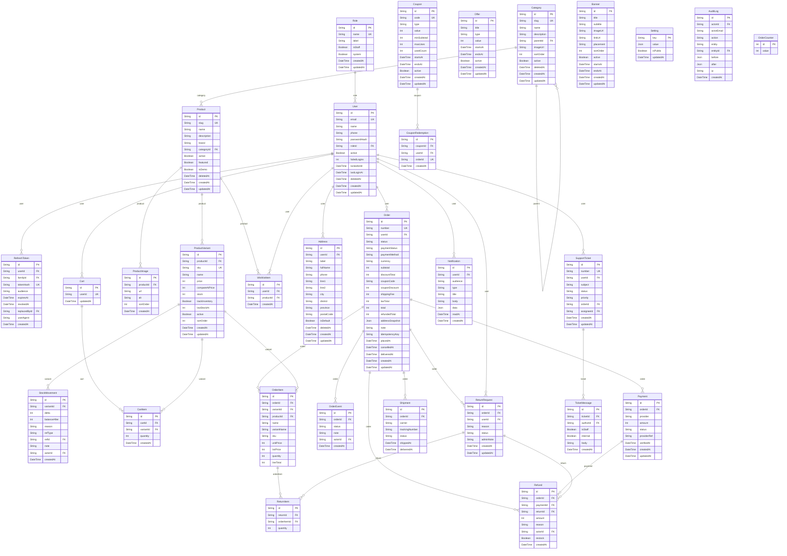

# S Mart data model

Source of truth: `prisma/schema.prisma` (30 models, 8 enums, one migration `20261104100708_init`). The diagram below was generated from that file on 2026-11-04; attributes show scalar columns only (PK/UK/FK marks are derived from `@id`, `@unique` and `*Id` names).

Conventions (observed in the schema): money is stored as integer minor units; ids are UUIDs; most tables carry `createdAt`/`updatedAt`; soft delete (`deletedAt`) is used on the models marked below; `OrderItem` and `Order.addressSnapshot` copy data at purchase time so later edits never rewrite history.

## Enums
- **OfferType**: percent, fixed
- **OrderStatus**: pending_payment, placed, confirmed, packed, shipped, out_for_delivery, delivered, cancelled, return_requested, returned, refunded
- **PaymentMethod**: cod, esewa, khalti, stripe
- **PaymentStatus**: unpaid, pending, paid, failed, partially_refunded, refunded
- **ReturnStatus**: requested, approved, rejected, received, refunded
- **StockReason**: initial, sale, cancel_restock, return_restock, adjustment, correction
- **TicketPriority**: low, normal, high, urgent
- **TicketStatus**: open, pending, resolved, closed

## Table notes
| Model | Purpose | Soft delete | Unique constraints | Indexes |
|---|---|---|---|---|
| Role | Named permission sets; permissions is a string array, "*" = all (super_admin). | no | - | - |
| User | Staff and customers in one table (role FK); argon2id hash, failed-login counter + lockedUntil, soft delete. | yes | - | (roleId); (createdAt) |
| RefreshToken | Opaque refresh tokens stored hashed; rotation chain used for reuse detection. | no | - | (userId); (familyId) |
| Category | Product categories (tree-capable). | yes | - | (parentId) |
| Product | Catalogue item; soft delete; slug unique. | yes | - | (categoryId); (active, deletedAt); (name) |
| ProductVariant | Sellable SKU with price and stock (stock is changed only by guarded UPDATEs). | no | - | (productId); (stock) |
| ProductImage | Image URLs for a product (files served by the storage driver). | no | - | (productId) |
| StockMovement | Append-only stock ledger: delta, balanceAfter, reason, ref to order. | no | - | (variantId, createdAt) |
| Offer | Time-boxed percent/fixed discounts on products or categories. | no | - | (startsAt, endsAt) |
| Coupon | Code-based discount with min subtotal, max uses and usedCount. | no | - | - |
| CouponRedemption | Which order used which coupon. | no | (couponId, userId, orderId) | (couponId, userId) |
| Banner | Homepage/app banners with schedule. | no | - | (placement, active) |
| Cart | One cart per customer. | no | - | - |
| CartItem | Variant + quantity in a cart. | no | (cartId, variantId) | - |
| WishlistItem | Customer wishlist entry. | no | (userId, productId) | - |
| Address | Customer address book; soft delete. | yes | - | (userId) |
| Order | Placed order; unique (userId, idempotencyKey); totals stored in minor units; addressSnapshot JSON. | no | (userId, idempotencyKey) | (userId, createdAt); (status, createdAt) |
| OrderItem | Line snapshot (name, unit price) at purchase time. | no | - | (orderId) |
| OrderEvent | Status timeline (powers tracking). | no | - | (orderId, createdAt) |
| Payment | Payment attempt/record per order and method; verifiedAt set only server-side. | no | - | (orderId) |
| Shipment | Carrier, tracking number, shipped/delivered timestamps. | no | - | (orderId) |
| ReturnRequest | Customer return request with admin decision. | no | - | (orderId); (userId) |
| ReturnItem | Items/quantities in a return. | no | - | - |
| Refund | Recorded refund amount per order/return. | no | - | (orderId) |
| Notification | In-app notifications per user. | no | - | (userId, createdAt); (audience, createdAt) |
| SupportTicket | Customer support ticket. | no | - | (userId); (status) |
| TicketMessage | Messages on a ticket (staff or customer). | no | - | (ticketId, createdAt) |
| Setting | Key/value app configuration; isPublic marks keys exposed by /catalog/config. | no | - | - |
| AuditLog | Who did what, entity, IP, metadata. | no | - | (entity, entityId); (actorId, createdAt); (createdAt) |
| OrderCounter | Single-row counter used to generate order numbers. | no | - | - |

## Invariants enforced in code (see ARCHITECTURE.md)
- `ProductVariant.stock` changes only through guarded SQL (`UPDATE ... WHERE stock >= qty`) inside a transaction and always writes a `StockMovement` row with `balanceAfter`.
- `Order(userId, idempotencyKey)` is unique, so a double-submitted checkout returns the first order.
- Order status moves only along the transitions in `packages/shared/src/orders.ts`; each move is claimed with `updateMany({ where: { id, status: previous } })` so two concurrent writers cannot both win.
- Not enforced by the database: row-level security (not used in S Mart; isolation is by ownership checks in the API, see SECURITY.md).
