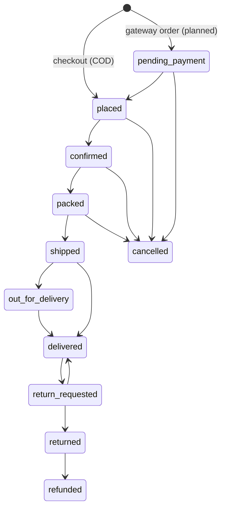

# S Mart product specification

Status date: 2026-11-04. S Mart is an original shopping product. Milestone 1 (M1) delivers one shared API plus an Admin website and a Customer website. The Android shopping app and Android admin app are **planned (M2)**; the Windows admin .EXE is **planned (M3)**. Nothing in this document claims an APK or EXE exists.

## 1. Goals
1. One secure backend and database that every interface talks to (no database credentials in any client).
2. A customer can browse, search, add to cart, check out with Cash on Delivery, track the order live, request a return and get refunded.
3. Staff run the shop from the Admin website: catalogue, stock, prices, offers, banners, orders, shipping, returns, refunds, customers, tickets, reports, audit log, backups.
4. Changes made by staff reach customers live where it makes sense (prices, banners, order status).
5. Honest, testable money handling: totals only on the server, paid only after server-side verification.

## 2. Personas
- **Customer** (Nepal-based online shopper, phone first): wants quick browsing, clear prices in NPR, simple COD checkout, clear order status.
- **Shop owner / admin**: wants a dashboard of sales, control over catalogue and staff permissions.
- **Order staff / support agent**: process and ship orders, answer tickets.
- **Inventory staff**: adjust stock without seeing finance data.
- **Finance**: sees payments, refunds, revenue, exports reports.

## 3. Interfaces
| Interface | Status | Notes |
|---|---|---|
| Shared REST API (`/api/v1`, NestJS + Prisma + PostgreSQL) | Implemented in API, tested by the API suite (counts: see the parent report) | 102 routes, Swagger at `/api/docs` outside production |
| Admin website (`apps/admin-web`, port 3100) | Built by parallel workers at time of writing; verified state is in the parent's final report | RBAC-aware navigation; the server enforces permissions |
| Customer website (`apps/customer-web`, port 3101) | Built by parallel workers at time of writing; verified state is in the parent's final report | Storefront-lite plus dashboard |
| Android shopping app | **Planned (M2)** | see PLATFORM_FEASIBILITY.md |
| Android admin app | **Planned (M2)** | push needs Nabin's Firebase project; SSE/polling is the free alternative |
| Windows admin .EXE | **Planned (M3)** | see PLATFORM_FEASIBILITY.md |

## 4. Information architecture
**Customer website**: Home (banners, categories, offers) / Catalogue (search, category, sort) / Product / Cart / Checkout / Account: Profile, Orders (+ detail with live timeline, cancel, return request), Wishlist, Addresses, Payments, Notifications, Support tickets.
**Admin website**: Dashboard / Products, Categories, Inventory (ledger, adjust), Offers, Coupons, Banners / Orders (detail, status, ship, refund), Returns, Payments / Customers / Tickets / Users and Roles / Settings / Audit log / Backups / Reports and exports.

## 5. Roles and permission matrix
Generated from `ROLE_DEFINITIONS` in `packages/shared/src/permissions.ts` (2026-11-04). `super_admin` holds `*` (everything, including `roles.manage`); `admin` holds everything except `roles.manage`. Custom roles can be created through `POST /admin/roles` (permission `roles.manage`).

| Permission | super_admin | admin | manager | inventory_staff | support_agent | order_staff | finance | customer |
|---|---|---|---|---|---|---|---|---|
| `dashboard.view` | yes | yes | yes | yes | yes | yes | yes | - |
| `analytics.view` | yes | yes | yes | - | - | - | yes | - |
| `products.read` | yes | yes | yes | yes | - | - | - | - |
| `products.write` | yes | yes | yes | - | - | - | - | - |
| `categories.write` | yes | yes | yes | - | - | - | - | - |
| `inventory.read` | yes | yes | yes | yes | - | - | - | - |
| `inventory.write` | yes | yes | yes | yes | - | - | - | - |
| `pricing.write` | yes | yes | yes | - | - | - | - | - |
| `banners.write` | yes | yes | yes | - | - | - | - | - |
| `orders.read` | yes | yes | yes | - | yes | yes | yes | - |
| `orders.update` | yes | yes | yes | - | - | yes | - | - |
| `orders.ship` | yes | yes | yes | - | - | yes | - | - |
| `orders.cancel` | yes | yes | yes | - | - | - | - | - |
| `customers.read` | yes | yes | yes | - | yes | yes | - | - |
| `customers.write` | yes | yes | - | - | - | - | - | - |
| `payments.read` | yes | yes | yes | - | - | - | yes | - |
| `refunds.write` | yes | yes | - | - | - | - | yes | - |
| `returns.manage` | yes | yes | yes | - | - | yes | - | - |
| `tickets.read` | yes | yes | yes | - | yes | - | - | - |
| `tickets.manage` | yes | yes | yes | - | yes | - | - | - |
| `notifications.manage` | yes | yes | - | - | yes | - | - | - |
| `users.manage` | yes | yes | - | - | - | - | - | - |
| `roles.manage` | yes | - | - | - | - | - | - | - |
| `settings.write` | yes | yes | - | - | - | - | - | - |
| `audit.read` | yes | yes | - | - | - | - | - | - |
| `backup.manage` | yes | yes | - | - | - | - | - | - |
| `reports.export` | yes | yes | yes | - | - | - | yes | - |
| `uploads.write` | yes | yes | yes | yes | - | - | - | - |

## 6. Feature list with honest status
| Area | Status |
|---|---|
| Register / login / refresh / logout / change password (JWT + rotating refresh, lockout) | Implemented in API |
| Roles, permissions, staff user management | Implemented in API |
| Categories, products, variants, images (local-disk storage behind a driver) | Implemented in API |
| Inventory with append-only stock ledger and manual adjustment | Implemented in API |
| Offers, coupons, banners; public catalogue endpoints | Implemented in API |
| Cart, wishlist, address book | Implemented in API |
| Checkout (COD) with idempotency key and server-side totals | Implemented in API |
| Order state machine, shipments, customer cancel | Implemented in API |
| Returns and refunds | Implemented in API |
| Notifications (in-app) and support tickets | Implemented in API |
| Realtime (SSE) | Implemented in API |
| Analytics summary and report export endpoint | Implemented in API (formats per `/admin/reports/:type`; see API.md) |
| Audit log, settings, backup / verify endpoints and scripts | Implemented in API + scripts |
| eSewa / Khalti / Stripe payments | **Interface only**; disabled until merchant keys are set; not tested against any provider |
| Push notifications (FCM) | **Planned**; needs a Firebase project |
| Email / SMS (verification, password reset, receipts) | **Planned**; needs a mail/SMS provider |
| MFA, CAPTCHA, virus scanning of uploads | **Not built** |
| Android apps, Windows EXE | **Planned (M2/M3)** |
| Reviews, multi-currency, multi-warehouse, delivery-zone pricing | Not built |

## 7. Order state machine
Transitions are defined in `packages/shared/src/orders.ts` (`canTransition`). Generated 2026-11-04.



```
  pending_payment   -> placed, cancelled
  placed            -> confirmed, cancelled
  confirmed         -> packed, cancelled
  packed            -> shipped, cancelled
  shipped           -> out_for_delivery, delivered
  out_for_delivery  -> delivered
  delivered         -> return_requested
  cancelled         -> (terminal)
  return_requested  -> returned, delivered
  returned          -> refunded
  refunded          -> (terminal)
```
- Checkout with COD creates the order as `placed` / payment `unpaid`; a gateway order would start at `pending_payment` (gateways are not enabled).
- Customers can cancel only in `pending_payment`, `placed`, `confirmed`. Staff can cancel before shipping (`packed` and earlier).
- Staff set `confirmed`, `packed`, `out_for_delivery`, `delivered`, `cancelled` through the status endpoint; `shipped` is set by the ship endpoint (carrier + tracking).
- Each change is claimed atomically (`UPDATE ... WHERE status = previous`), written to `OrderEvent` (the tracking timeline) and pushed over SSE.

## 8. Returns and refunds
- A return can be requested only for a `delivered` order within `returnWindowDays` (setting, default 7 days) of delivery.
- Staff with `returns.manage` approve or reject; restocking of returned items uses the stock-ledger reason `return_restock` (see `restock()` in `apps/api/src/orders/orders.service.ts`; the exact trigger point was not re-verified for this document).
- Refunds are recorded by staff with `refunds.write`; order status moves `returned` -> `refunded`. The refund record is a bookkeeping entry: S Mart does not move money. For COD the shop pays the customer outside the system until a gateway is connected.

## 9. Payment policy
- Only **Cash on Delivery** is live. COD is marked paid when staff record the order as delivered (server-side).
- eSewa, Khalti and Stripe exist as provider interfaces that report "not enabled" until the matching secret key is set in the environment. No sandbox or live call has been made.
- An order becomes `paid` only through a server-side step; the browser or app can never mark an order paid.
- Card data is never collected, stored or logged by S Mart. A card gateway would host the card form.

## 10. Security model
Summarised in SECURITY.md; architecture in ARCHITECTURE.md.
